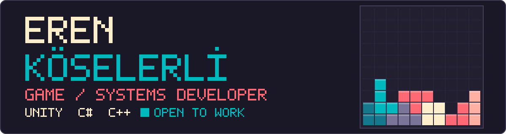
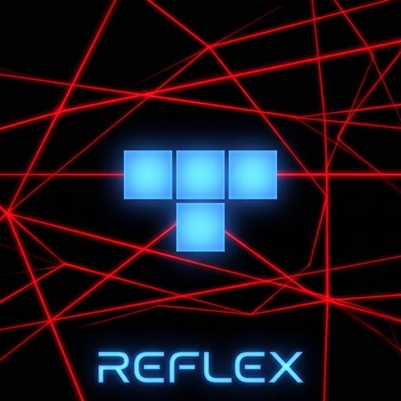

  

  

    
    
    
  

Game developer with a Software Engineering degree and commercial experience at Blay Games, where I took **OROBOROS** to Steam as the sole port developer, worked on **GOKA Street**, and built multiplayer systems for **Kiss Cargo**. I care most about gameplay feel and the architecture that keeps it easy to change.

**Looking for:** gameplay or systems programming roles.

<table>
  <tr><td><b>Languages</b></td><td>C#, C++17 · also Java, Python</td></tr>
  <tr><td><b>Unity</b></td><td>Unity 6, URP, Render Graph, Input System, NavMesh, ScriptableObjects, Cinemachine</td></tr>
  <tr><td><b>Libraries</b></td><td>Normcore, UniTask, DOTween, Odin Inspector, SFML 3</td></tr>
  <tr><td><b>Patterns</b></td><td>State, Command, Composite, Factory, ECS, event bus</td></tr>
  <tr><td><b>Education</b></td><td>BSc Software Engineering, İzmir University of Economics, 2025</td></tr>
</table>

## Commercial work

**Blay Games** · Game Developer, Jul 2025 – Mar 2026 · Intern, Oct 2024 – Mar 2025

<table>
  <tr>
    <td width="33%" valign="top">
      
       <b>OROBOROS</b> 
      Released Nov 2025  
      Sole developer on the Steam port. Handled all codebase adaptations and UI through to release.
    </td>
    <td width="33%" valign="top">
      
       <b>GOKA Street</b> 
      Released Dec 2025  
      Part of the programming team on core mechanics, and supported the Steam release.
    </td>
    <td width="33%" valign="top">
      
       <b>Kiss Cargo</b> 
      Upcoming on Steam  
      Built the real-time multiplayer systems with Normcore.
    </td>
  </tr>
</table>

Earlier: maintained the live mobile title *Alice in Blastland* at Blay Games, and worked as a test and QA intern at Testinium (Java, Selenium, Gauge).

## Selected projects

<table>
  <tr>
    <td width="42%" valign="top">
      
    </td>
    <td valign="top">
      <h3><a href="https://github.com/Astrobotiq/Into-The-Night">Into the Night</a></h3>
      3D grid tactics inspired by Into The Breach · Unity, C# · capstone, team of two
      <ul>
        <li>Designed a Utility AI where each enemy type scores the grid to pick attack positions and avoid hazards</li>
        <li>Custom A* pathfinding, plus factories that build entities and levels from ScriptableObject data</li>
        <li>Contracts such as <code>IDamagable</code> and <code>IPushable</code> keep combat systems decoupled</li>
      </ul>
    </td>
  </tr>
  <tr>
    <td width="42%" valign="top">
      
    </td>
    <td valign="top">
      <h3><a href="https://github.com/Astrobotiq/RockTheGame">Slingshot</a></h3>
      2D precision platformer · Unity, C# · in development · repo: RockTheGame
      <ul>
        <li>Replaced my first Spring Joint grapple with a custom kinematic controller that handles its own collision, ground and wall sensing</li>
        <li>Player logic built on the State pattern: dash, wall slide and climb, ledge climb, swing, dual swing, slingshot</li>
        <li>22 EditMode tests covering movement logic and tuning data</li>
      </ul>
    </td>
  </tr>
  <tr>
    <td width="42%" valign="top" align="center">
      
    </td>
    <td valign="top">
      <h3><a href="https://github.com/Astrobotiq/Tetris-Reflex">Tetris Reflex on SimpleEngine2D</a></h3>
      Custom 2D engine and game · C++17, SFML 3, CMake · solo
      <ul>
        <li>Wrote the engine myself: ECS core, scene and input management, rendering, audio and particles</li>
        <li>Drag-and-drop piece placement and a slot machine system with 15 unlockable powers</li>
      </ul>
    </td>
  </tr>
  <tr>
    <td width="42%" valign="top">
      
    </td>
    <td valign="top">
      <h3><a href="https://github.com/Astrobotiq/Dance-Battle">Dance Battle</a></h3>
      Turn-based card game · Unity, C# · course project, team of two
      <ul>
        <li>Card effects built from ScriptableObjects on an abstract base, so new cards need little or no new code</li>
        <li>Battle flow runs on a state machine with separate player, enemy and crowd turns</li>
      </ul>
    </td>
  </tr>
</table>

**Also worth a look**

- **[Pikmin Clone](https://github.com/Astrobotiq/Pikmin_Clone)**: minion control prototype using the Command pattern, swappable circle, grid and wedge formations, and NavMesh agents.
- **[Shh, Do Not Wake The Baby!](https://github.com/Astrobotiq/Shh-Do-Not-Wake-The-Baby)**: defence game where noise is the fail state. Placeable obstacles reshape enemy paths through a runtime NavMesh.

## Open-source Unity tools

| Package | What it does |
|:---|:---|
| **[CRT Filter for URP](https://github.com/Astrobotiq/crt-filter-urp)** | CRT post-processing built on the Unity 6 Render Graph API. Hand-written shader, installs through UPM. |
| **[Material Property Tweener](https://github.com/Astrobotiq/Material-Property-Tool)** | Inspector-driven shader animation using `MaterialPropertyBlock`, so objects need no material copies. Composite tween tree, UniTask, visual timeline, edit-mode preview. |

## Currently

Learning Unity DOTS and going deeper on C++ through SimpleEngine2D.

**Hiring?** [koselerlie@gmail.com](mailto:koselerlie@gmail.com) is the fastest way to reach me. More detail and devlogs are on my [portfolio](https://astrobotiq.github.io/Portfolio/).
